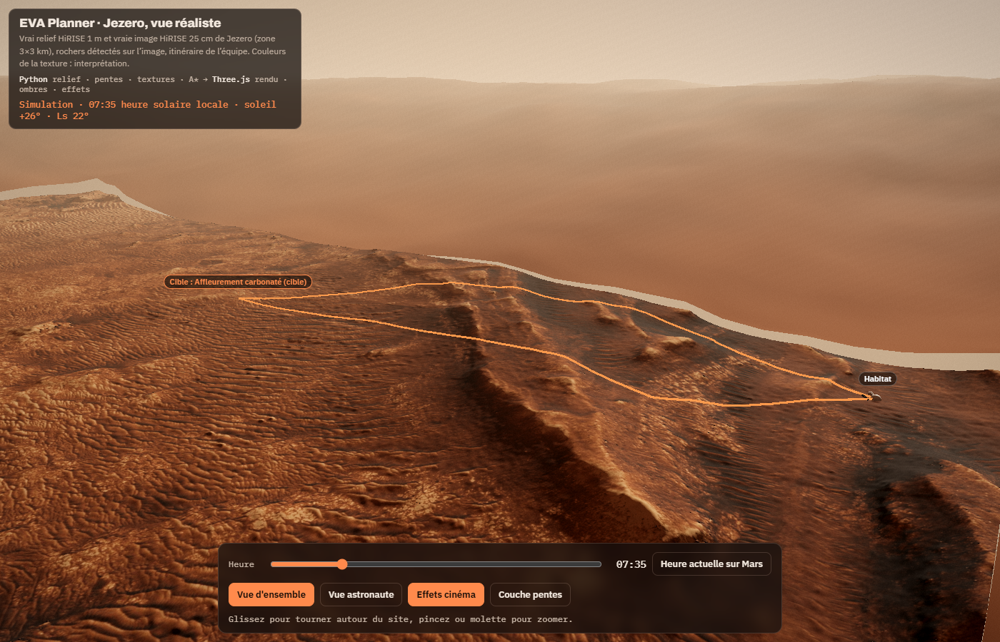
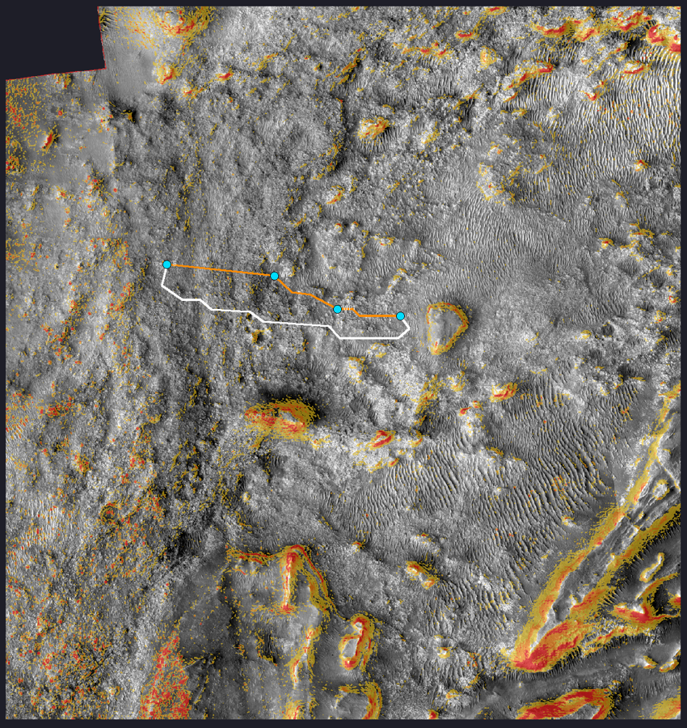
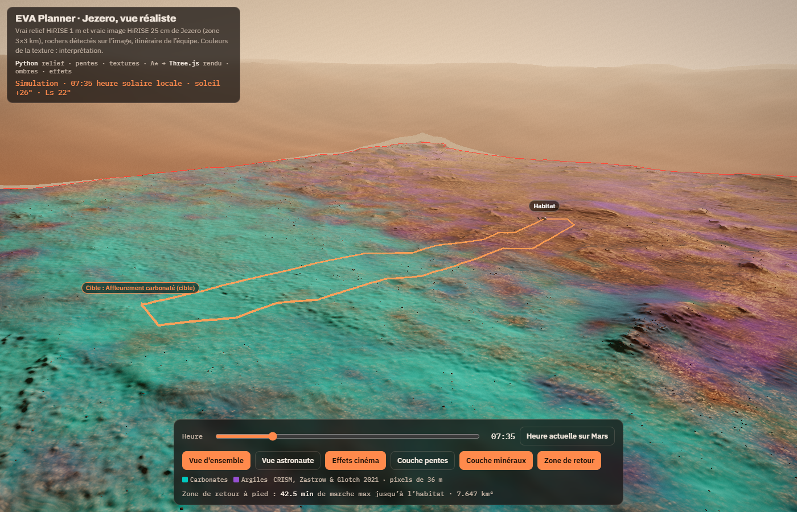

# EVA Planner — Documentation du backend et des données

*Rédigée les 14 et 15 novembre 2026. Référence de conception : `Guide_EVA_Planner_architecture_v2.docx`.*

Ce document décrit tout ce qui a été fait côté **données et backend** : l'inventaire des fichiers NASA,
les décisions prises, l'API, les calculs, l'imprévu DONKI, les tuiles de carte (ortho, pentes, thermique),
la météo MEDA, les radiations RAD, l'export de la vue 3D, et ce qu'il reste à faire.



*Vue 3D Three.js : vrai relief HiRISE 1 m, vraie image HiRISE 25 cm teintée, rochers détectés, boucle habitat → cible.*

> **Formats de chaque jeu de données et détail des traitements : [docs/DONNEES.md](docs/DONNEES.md)**



*Zone 3×3 km. Fond : orthoimage HiRISE 25 cm. Couleurs : pentes 10–15° (jaune), 15–20° (orange), > 20° (rouge).
Orange : aller A → B. Blanc : retour. Points cyan : habitat A, waypoints, cible B.*

---

## Sommaire

1. [Démarrage rapide](#1-démarrage-rapide)
2. [Inventaire des données NASA](#2-inventaire-des-données-nasa)
3. [Problèmes trouvés dans les données](#3-problèmes-trouvés-dans-les-données)
4. [Décisions prises](#4-décisions-prises)
5. [Architecture du backend](#5-architecture-du-backend)
6. [Référence de l'API](#6-référence-de-lapi)
7. [Méthode de calcul](#7-méthode-de-calcul)
8. [Scope & Data Gate](#8-scope--data-gate)
9. [Imprévus : catalogue, évaluation, DONKI](#9-imprévus--catalogue-évaluation-donki)
10. [Tuiles de carte (Leaflet)](#10-tuiles-de-carte-leaflet)
11. [Intégration côté front](#11-intégration-côté-front)
12. [Les six types de données du défi](#12-les-six-types-de-données-du-défi)
13. [Météo MEDA](#13-météo-meda)
14. [Radiations RAD](#14-radiations-rad)
15. [Briefing GO / NO-GO](#15-briefing-go--no-go)
16. [Vue 3D réaliste (export_3d.py)](#16-vue-3d-réaliste-export_3dpy)
17. [CesiumJS](#17-cesiumjs)
18. [Tests](#18-tests)
19. [Ce qu'il reste à faire](#19-ce-quil-reste-à-faire)

---

## 1. Démarrage rapide

Windows, invite de commandes (cmd) :

```bat
cd nasa
python -m venv .venv
.venv\Scripts\activate
pip install -r backend\requirements.txt

cd backend
:: Une seule fois (les résultats sont déjà dans data/ si le dépôt les contient) :
python scripts\make_tiles.py      :: tuiles ortho + pentes + thermique (~1 min 30)
python scripts\export_3d.py       :: données réelles de la vue 3D -> nasa\assets\ (~1 min)
python scripts\fetch_meda.py      :: météo MEDA (téléchargement lent : ~50 Mo, 5-10 min)
python scripts\fetch_rad.py       :: radiations RAD (~60 Mo, 5-10 min)
python scripts\fetch_donki.py     :: imprévu éruption solaire

uvicorn app.main:app --reload
```

- API : http://127.0.0.1:8000
- Documentation interactive (tester chaque route) : http://127.0.0.1:8000/docs
- **Vue 3D réaliste : http://127.0.0.1:8000/3d**

Python 3.14 fonctionne (testé avec rasterio 1.5.2 / GDAL 3.12.2 installés par pip). Conda n'est pas nécessaire.

---

## 2. Inventaire des données NASA

Tout est dans `nasa/data/`.

| Fichier / dossier | Format | Contenu | Taille | Utilisé ? |
|---|---|---|---|---|
| `JEZ_hirise_soc_006_DTM_MOLAtopography_DeltaGeoid_1m_Eqc_latTs0_lon0_blend40.tif` | GeoTIFF float32, 21 400 × 21 488 px | **Relief HiRISE 1 m** (mosaïque Mars 2020 TRN), « pas de donnée » = −3,4e38 | 1,8 Go | ✅ calculs + pentes |
| `JEZ_hirise_soc_006_orthoMosaic_25cm_Eqc_latTs0_lon0_first.tif` | **BigTIFF** uint8, 85 600 × 85 952 px | **Orthoimage HiRISE 25 cm**, niveaux de gris, « pas de donnée » = 0 | 6,9 Go | ✅ tuiles de fond |
| `data_input/*_ssa.img` + `.hdr` | ENVI, BSQ, float32, little-endian, 285 × 478 px | Cubes CRISM d'albédo de diffusion simple. 244 bandes (2,65 → ~1 µm), 194 pour les `_2cuts` | 1,6 Go | Remplacés par `data_models` (résultats déjà calculés) |
| `data_models/*.nc` | **NetCDF4**, géoréférencé (`CRISM_LAT_15_0`, pixels de 36 m) | Résultats du démélange : % de 8 groupes et 21 minéraux par pixel, spectres mesuré et modélisé, 60 indices CRISM | 20 Go | ✅ placement du point B |
| `data_roi/marginal_region_040ff.*` | Shapefile, 897 polygones (pixels CRISM) | **Région des carbonates marginaux** (Zastrow & Glotch 2021) | 186 Ko | ✅ choix du point B |
| `code_unmixing/` | Scripts Davinci + HDF n,k | Code du démélange spectral de l'article | 92 Ko | ❌ pas nécessaire si `data_models.zip` |
| `sim3464_JezeroNili_FINAL/` | Esri File Geodatabase + GeoTIFF | Carte géologique USGS SIM 3464, CTX 20 m / 6 m, HRSC, THEMIS | 492 Mo | ✅ THEMIS IR de jour (couche thermique) ; ⏳ géologie |
| *Téléchargé* : MEDA (PDS Atmospheres) | CSV, ~1 mesure/s | Météo de Perseverance **à Jezero**, sols 300–302 | ~50 Mo (cache) | ✅ `/weather` |
| *Téléchargé* : RAD (PDS PPI) | ASCII PDS3 | Dose de Curiosity **à Gale**, sols 361–365 | ~60 Mo (cache) | ✅ `/radiation` |
| *Téléchargé* : DONKI (api.nasa.gov) | JSON | Flux de particules solaires du 11 mai 2024 (éruption X5.8) | petit | ✅ `/incidents` |
| `PIA23179.tif` | TIFF | Image presse NASA | 14 Mo | ❌ |
| `InSight_..._fgdc.xml` | Métadonnées FGDC | **Elysium Planitia** (site InSight), pas Jezero | 8 Ko | ❌ hors sujet |

**Projection des deux fichiers HiRISE** : Equirectangular, sphère Mars 2000 IAU (R = 3 396 190 m),
latitude standard 0°, méridien 0°. Emprise : 77,22–77,58°E, 18,31–18,67°N (environ 21 × 21 km).

**Dépôt Zenodo des carbonates** ([zenodo.org/records/4699583](https://zenodo.org/records/4699583)) — 4 archives :

| Archive | Taille | Présente ? |
|---|---|---|
| `code_unmixing.zip` | 49 Ko | ✅ |
| `data_input.zip` | 1,4 Go | ✅ |
| `data_roi.zip` | 61 Ko | ✅ |
| `data_models.zip` | **6,8 Go** | ✅ **reçu et extrait** (20 Go, 18 fichiers NetCDF) : cartes d'abondance |

---

## 3. Problèmes trouvés dans les données

| Problème | Conséquence | Traitement |
|---|---|---|
| Fichiers HiRISE énormes (8,7 Go) | Impossible à charger en mémoire ou dans un navigateur | Le backend lit **uniquement les pixels utiles** ; les tuiles ne couvrent que la zone 3×3 km (97 Mo) |
| Deux rayons de Mars différents : 3 396 190 m (HiRISE, USGS) et **3 394 839 m** (CRISM / ROI) | Décalage de plusieurs centaines de mètres si on mélange | Conversions explicites dans `app/geo.py` (`lonlat_to_dtm`, `lonlat_to_crism`) |
| ROI en projection `CRISM_LAT_15_0` (parallèle standard 15°) | pyproj gère mal ces systèmes martiens | Formules écrites à la main et testées |
| Trous dans le DTM (1,35 % de la zone) | Altitudes manquantes | Interpolées le long du tracé ; part signalée dans `nodata_fraction` |
| `API_ou_telechargement_EVA_Planner.pdf` corrompu (pages blanches) | — | À réexporter |
| `USGS ... sim3464.pdf` fait 0 octet | — | À retélécharger (non bloquant) |
| `__MACOSX/`, `.DS_Store` | Fichiers parasites macOS | À supprimer |
| Endpoint DONKI `FLR` de api.nasa.gov → **HTTP 404** | Pas d'accès direct aux éruptions | Le script passe par `SEP` + notifications (voir §9) |

---

## 4. Décisions prises

| Décision | Valeur | Raison |
|---|---|---|
| **Zone de travail** | **3 × 3 km** centrée sur **18,5456°N / 77,3628°E** | Seule zone où l'on a de vraies données CRISM ; 3 km pour garder toute la ROI (2,8 × 2,6 km) |
| Emprise (projection du DTM) | x 4 584 155 → 4 587 155 m, y 1 097 784 → 1 100 784 m | Dans `config.ZONE_BBOX_M` |
| Emprise (degrés) | lon 77,3375 → 77,3881°E, lat 18,5203 → 18,5709°N | — |
| Projection de référence | Celle du DTM HiRISE | C'est la donnée maître |
| Coordonnées échangées avec le front | **Degrés lon/lat Mars 2000** (GeoJSON) | Standard, lisible, compatible Leaflet |
| Distances | **Grand cercle sur la sphère martienne** (haversine, R = 3 396 190 m) | « Les degrés ne sont pas des mètres » (guide §2) |
| Tracé | **Prédéfini en GeoJSON**, A* non implémenté | Guide v2 : A* = bonus après le MVP |
| Scénario EVA-03 | Adapté au vrai terrain, distances non figées | Choix de l'équipe |

**Points (version 2 du 15/11, dans `data/route.geojson`)** — déplacés vers la zone riche en carbonate,
à la demande de l'équipe :

| Point | Coordonnées | Pourquoi ici |
|---|---|---|
| Habitat (A) | 77,36708°E / 18,54888°N | Terrain très plat (pente max 1,6° sur 60 m), près du centre de la zone, à plus de 400 m des bords |
| WP1 « Plateau central » | 77,36235°E / 18,54938°N | Sommet du tracé de moindre pente |
| WP2 « Approche des affleurements » | 77,35763°E / 18,55174°N | Entrée dans la zone carbonatée |
| Cible (B) | 77,34957°E / 18,55257°N | Sur un polygone **« Majority MC »** de la ROI ; **36,1 % de carbonate** (moyenne 3 × 3 : 34,2 %), **confirmé par une seconde observation CRISM (05c5e) : 34,2 %** ; parmi les pixels les plus riches de la zone |

Résultat : aller **1 042 m** (pente max 7,8°, 25,0 min), retour **1 281 m** (7,6°, 30,7 min), aucun passage difficile.

**Ajustement du 15/11** : la cible était d'abord à 77,34991 / 18,55196 (36,6 % dans le pixel CRISM de 36 m), mais
le shapefile la classait « Majority sand » (sable). Elle a été déplacée de 68 m sur le polygone « Majority MC »
voisin : on vise un affleurement, pas du sable.

**Méthode de placement** :
1. Amas de carbonate ≥ 32 % (moyenne 3 × 3 pixels, cartes d'abondance de `data_models`) dans la ROI, avec une
   pente locale < 12°.
2. Habitat : zone de 60 m la plus plate, à 1–1,4 km de B et à plus de 400 m des bords.
3. Tracés : chemin de moindre coût sur une grille de pentes de 10 m (coût = longueur × (1 + (pente/8)²), pentes > 15°
   interdites), simplifié à 12 m près. Pour le retour, les cellules à moins de 80 m de l'aller coûtent 4 fois plus,
   ce qui donne un chemin différent. **Ce calcul a seulement servi à dessiner le GeoJSON** : l'application reste
   sur un tracé prédéfini, comme le demande le guide.

**Version 1 abandonnée** : habitat 77,38538 / 18,52298, cible 77,38035 / 18,54224. Une fois `data_models` reçu,
il est apparu que cette cible n'avait que **8 % de carbonate** (53 % d'argiles), et l'habitat était à 160 m du bord
de la zone.

---

## 5. Architecture du backend

```
nasa/backend/
├── app/
│   ├── main.py        Routes FastAPI
│   ├── config.py      TOUS les paramètres (chemins, seuils, vitesse, autonomie)
│   ├── geo.py         Conversions Mars (degrés ↔ mètres HiRISE / CRISM), haversine, densification
│   ├── terrain.py     Lecture du DTM + calcul des caractéristiques d'un tracé
│   ├── autonomy.py    Formule unique d'autonomie + règle d'ajout d'arrêt
│   ├── gate.py        Scope & Data Gate
│   ├── environment.py Météo (MEDA) et radiations (RAD) : lecture + critères GO / NO-GO
│   ├── minerals.py    Cartes d'abondance CRISM (data_models) : composition, spectre, contrôle carbonate
│   ├── incidents.py   Catalogue des imprévus et évaluation en situation
│   ├── return_zone.py Zone de retour à pied (Dijkstra sur le relief)
│   └── route.py       Chargement et validation du GeoJSON
├── scripts/
│   ├── fetch_donki.py Récupère et met en cache un événement DONKI réel
│   ├── fetch_meda.py  Télécharge et résume la météo MEDA (Jezero)
│   ├── fetch_rad.py   Télécharge et résume la dose RAD (Gale)
│   ├── make_tiles.py  Génère les tuiles Leaflet (ortho, pentes, thermique)
│   └── export_3d.py   Exporte les données réelles de la vue 3D (nasa/assets/)
├── data/
│   ├── route.geojson  Tracé provisoire
│   ├── sources.json   Crédits / statut réel ou simulé de chaque couche
│   ├── incidents/     Imprévus prêts à rejouer
│   ├── donki_raw/     Réponses DONKI brutes (cache hors ligne)
│   ├── meteo/         Résumés MEDA (JSON)
│   ├── radiation/     Résumé + détail RAD (JSON, CSV)
│   ├── meda_raw/, rad_raw/   CSV / TXT bruts (cache, non versionnés)
│   └── tiles/         Tuiles PNG + metadata.json
├── tests/             37 tests (calculs + API)
├── docs/              Aperçus (zone, vue 3D)
├── requirements.txt
└── README.md
```

**Choix techniques** (conformes au guide v2, §4) : FastAPI, rasterio, NumPy, geopandas/shapely (ROI),
Pillow (tuiles). Pas de base de données, pas de WebSocket : tout est en fichiers locaux, la démo marche sans internet.

**Paramètres de simulation** — tous dans `app/config.py`, modifiables sans toucher au code par variable
d'environnement `EVA_<NOM>` (exemple : `set EVA_WALK_SPEED_KMH=3`) :

| Paramètre | Valeur | Rôle |
|---|---|---|
| `WALK_SPEED_KMH` | 2,5 | Vitesse de marche simulée |
| `AUTONOMY_MIN` | 120 | Autonomie disponible (fictive) |
| `RESERVE_MIN` | 20 | Réserve minimale |
| `CAUTION_BUFFER_MIN` | 15 | Orange si marge < réserve + 15 |
| `SLOPE_CAUTION_DEG` / `HARD` / `MAX` | 10 / 15 / 20 | Seuils de pente attention / difficile / interdit |
| `SAMPLE_STEP_M` | 2 | Pas d'échantillonnage du DTM le long du tracé |
| `SLOPE_WINDOW_M` | 10 | Fenêtre de calcul des pentes |
| `GAIN_THRESHOLD_M` | 0,5 | Seuil anti-bruit du cumul de dénivelé |
| `WIND_CAUTION_MS` / `WIND_NOGO_MS` | 15 / 25 | Vent (moyenne 1 min) : orange / rouge |
| `AIR_TEMP_MIN_C` | −90 | Température d'air sous laquelle la sortie est NO-GO |
| `CARBONATE_MIN_PCT` | 20 | % de carbonate minimal (moyenne 3 × 3) au point B pour valider le Data Gate |
| `CAREER_LIMIT_MSV` | 600 | Limite de carrière NASA, affichée comme repère |

Ce sont des **valeurs de démonstration**, pas des normes NASA (guide §8).

---

## 6. Référence de l'API

| Méthode | Route | Rôle |
|---|---|---|
| GET | `/health` | État du serveur, DTM chargé ou non |
| GET | `/config` | Paramètres de simulation (le front affiche **ces** valeurs) |
| GET | `/map` | Centre, emprise, couches de tuiles et légende des pentes |
| GET | `/tiles/{couche}/{z}/{x}/{y}.png` | Tuiles (`ortho` z13–18, `slope` z13–17, `thermal` z13–16) |
| GET | `/weather` | Météo MEDA du dernier sol + critère GO / NO-GO |
| GET | `/weather/hourly` | Profil heure par heure (air, sol, pression, vent) |
| GET | `/minerals/point?lon=&lat=` | Composition minérale (% par groupe et par minéral, moyenne 3 × 3, erreur d'ajustement). Par défaut : le point B |
| GET | `/minerals/spectrum?lon=&lat=` | Spectre mesuré et modélisé (171 longueurs d'onde, 1,04–2,49 µm). Par défaut : le point B |
| GET | `/radiation` | Débit de dose RAD |
| GET | `/radiation/eva?duration_min=` | Dose estimée de la sortie (par défaut : durée du plan) |
| GET | `/briefing` | Décision GO / GO sous réserve / NO-GO, avec le détail par critère |
| GET | `/3d` | Page de la vue 3D (`nasa/index.html`) |
| GET | `/assets/...` | Données de la vue 3D (`data.json`, textures) |
| GET | `/layers` | Sources et statut (réel / simulé) de chaque couche |
| GET | `/route` | Tracé GeoJSON complet |
| GET | `/route/stats?leg=aller\|retour&profile=true` | Caractéristiques du tracé calculées sur le DTM |
| GET | `/gate` | Scope & Data Gate |
| POST | `/autonomy` | Calcul de la marge et du statut |
| POST | `/autonomy/add-stop` | Tente d'ajouter un arrêt |
| GET | `/autonomy/plan?observation_min=15` | Budget au départ, à partir des durées réelles du tracé |
| GET | `/incidents` | Catalogue des imprévus (8 : 1 réel DONKI + 7 scénarios du workflow) |
| GET | `/incidents/{id}` | Détail d'un imprévu (effets, messages des 3 écrans) |
| POST | `/incidents/evaluate` | Évaluation en situation : options de retour, marge, statut, décision |
| GET | `/return-zone` | Zone de retour à pied (GeoJSON), au départ ou en cours de sortie, avec ou sans imprévu |

### Exemples de réponses (valeurs réelles du tracé, version 2)

`GET /route/stats?leg=aller&profile=false`
```json
{
  "distance_m": 1042.0,
  "elevation_min_m": -2412.31, "elevation_max_m": -2372.96, "elevation_range_m": 39.35,
  "elevation_gain_m": 40.8, "elevation_loss_m": 1.9,
  "slope_max_deg": 7.8, "slope_mean_deg": 2.6,
  "duration_walk_min": 25.0,
  "nodata_fraction": 0.0,
  "waypoint_distances_m": [0.0, 170.8, 212.1, 278.4, 406.7, 483.2, 586.4, 1042.0],
  "difficult_segments": []
}
```
`waypoint_distances_m` donne la distance cumulée à chaque **sommet** de la ligne (pas seulement aux waypoints nommés).
Avec `profile=true` (par défaut), on reçoit aussi `profile` : `[{"d": distance_m, "z": altitude_m, "slope": degrés}, …]`
tous les 10 m, pour tracer le profil d'altitude.

Retour : 1 280,5 m, pente max 7,6°, 30,7 min, aucun passage difficile.

`GET /autonomy/plan`
```json
{"autonomy_min": 120.0, "outbound_remaining_min": 25.0, "observation_min": 15.0,
 "return_min": 30.7, "reserve_min": 20.0, "margin_min": 49.3,
 "status": "vert", "message": "Marge suffisante : poursuivre.", "simulated": true}
```

`POST /autonomy/add-stop` — corps :
```json
{"outbound_remaining_min": 35, "observation_min": 15, "return_min": 40, "extra_stop_min": 15}
```
Réponse : `"accepted": false`, avec `"reason": "Arrêt refusé : la marge tomberait à 15.0 min, sous la réserve de 20.0 min. Retour recommandé."`,
plus l'état `before` et `after`.

Les entrées négatives sont refusées (HTTP 422).

---

## 7. Méthode de calcul

Fichier `app/terrain.py`, conforme au guide §4.

1. **Densification** : le tracé est découpé en points tous les 2 m.
2. **Altitude** : chaque point est converti en mètres HiRISE (`x = R·lon`, `y = R·lat` en radians) puis lu dans
   le DTM. Seuls ces pixels sont lus, jamais le fichier entier.
3. **Trous** : les valeurs manquantes sont interpolées le long du tracé. Un tracé entièrement hors DTM est refusé.
4. **Distance** : somme des distances de grand cercle entre points successifs.
5. **Pente** : le profil est rééchantillonné tous les 10 m. Pente = `atan(|Δz| / Δd)` sur chaque tronçon.
   La fenêtre de 10 m évite que le bruit des pixels de 1 m donne des pentes irréalistes.
6. **Dénivelé** : `elevation_range_m` = max − min (définition du guide). En plus : cumul positif et négatif
   avec un seuil de 0,5 m pour ignorer le bruit.
7. **Segments difficiles** : tronçons consécutifs ≥ 10°, classés `attention` (10–15°), `difficile` (15–20°),
   `interdit` (≥ 20°).
8. **Durée** = distance / vitesse simulée.

**Autonomie** (`app/autonomy.py`, guide §5) — une seule formule partout :

```
Marge = Autonomie − (Aller restant + Observation + Retour)
rouge  : marge < réserve
orange : marge < réserve + 15 min
vert   : sinon
```
Ajout d'un arrêt : accepté seulement si la nouvelle marge reste ≥ réserve. **Modèle pédagogique**, pas un modèle
physique de consommation d'oxygène. Toutes les réponses portent `"simulated": true`.

---

## 8. Scope & Data Gate

Étape **bloquante P0** du guide (§3). `GET /gate` vérifie :

| Vérification | Résultat actuel |
|---|---|
| Le DTM couvre tout le tracé | ✅ |
| Le point B est dans la ROI carbonates (shapefile Zastrow & Glotch), sur une classe « Majority MC » ou « Mixture » (pas « sand », « MT » ni « Other ») | ✅ classe « Majority MC » |
| La signature carbonate est confirmée au point B | ✅ **36,6 % de carbonate** (moyenne 3 × 3 : 35,9 %, seuil 20 %), lu automatiquement dans les cartes d'abondance `data_models` |

Verdict de `/gate` : **`valide`**.

**Règle du contrôle carbonate** (`app/minerals.py`, `carbonate_check`) : on prend le pourcentage du groupe
« Carbonate » dans les cartes d'abondance Zastrow & Glotch, en **moyenne sur 3 × 3 pixels** (≈ 108 m), ce qui tolère
un décalage de recalage d'un pixel. Le seuil `CARBONATE_MIN_PCT` vaut **20 %** (paramètre de démonstration ; repères :
médiane de la zone ≈ 14 %, 90e percentile ≈ 31 %). Si le point B sort de l'emprise CRISM ou passe sous le seuil, le
verdict devient `bloque`. Le message à afficher reste « signature compatible avec des carbonates », jamais « carbone
détecté » ni « preuve de vie ».

Le contrôle a été validé à rebours : l'ancien point B (8 %) est bien refusé (test automatique).

**Confirmation indépendante** : l'observation CRISM **05c5e** (autre passage de la sonde) couvre aussi le point B et
donne **34,2 %** de carbonate (040ff : 36,1 %). Le message du contrôle l'indique ; un désaccord serait signalé.
L'observation 047a3 ne couvre pas le point B.

Le test « point dans la ROI » convertit le point B dans la projection CRISM (`lonlat_to_crism`), puis teste
l'inclusion dans les 897 polygones avec shapely.

---

## 9. Imprévus : catalogue, évaluation, DONKI

### 9.1 Catalogue (`data/incidents/*.json`, `GET /incidents`)

Aligné sur la partie 3 du dossier workflow. Chaque fichier contient : titre, niveau, moments possibles, message,
**effets chiffrés**, et un texte pour chacun des **trois écrans** (habitat, tablette, casque).

| id | Code workflow | Niveau | Effets appliqués au calcul | Décision typique |
|---|---|---|---|---|
| `solar_particles_2024-05-11` | D1 / A2 | rouge | retour immédiat, chemin le plus court | RETOUR IMMÉDIAT — **événement réel DONKI (éruption X5.8)** |
| `tempete_poussiere` | D4 / A1 | rouge | retour immédiat par le chemin connu, vitesse × 0,7 | RETOUR IMMÉDIAT (guidé par les balises) |
| `coequipier_blesse` | D3 | rouge | retour immédiat, vitesse × 0,5 → zone de retour réduite | RETOUR IMMÉDIAT |
| `fuite_oxygene` | D2 | rouge | retour immédiat, consommation × 2 | RETOUR IMMÉDIAT |
| `obstacle` | B1 | orange | détour + 68 m | CONTINUER (ou RETOUR si la marge ne tient plus) |
| `perte_radio` | B4 | orange | délai de décision 30 min | CONTINUER PRUDEMMENT |
| `panne_foreuse` | C2 | orange | station − 5 min (plan B) | CONTINUER |
| `surconsommation_oxygene` | C3 | orange | consommation × 1,15 | CONTINUER ou ADAPTER |

Seul l'imprévu solaire est un **événement réel** ; les autres sont des **scénarios** (`"simulation": true`).

### 9.2 Évaluation en situation (`POST /incidents/evaluate`)

Question posée : « l'astronaute est **ici**, il s'est écoulé **T** minutes, **tel** imprévu arrive : que faire ? »

Entrée :
```json
{"incident_id": "coequipier_blesse", "phase": "station", "distance_m": 0, "elapsed_min": 40}
```
`phase` = `aller` | `station` | `retour` ; `distance_m` = distance parcourue sur la phase en cours.

Calcul :
1. Position (lon/lat) interpolée sur le tracé.
2. **Options de retour** : demi-tour par l'aller, retour prévu, suite du retour, et **chemin le plus court sur le
   terrain** (Dijkstra de la zone de retour, pentes < 20°). Temps = distance / (2,5 km/h × facteur de vitesse) + détour.
3. Autonomie restante = (120 − temps écoulé) / facteur de consommation.
4. Si l'imprévu impose le retour : on prend l'option la plus rapide (chemin connu ou plus court selon l'imprévu).
   Sinon : temps nécessaire = suite du plan (aller restant + observation ajustée + retour).
5. Marge = autonomie restante − temps nécessaire, puis statut (même règle que `/autonomy`) et décision :
   RETOUR IMMÉDIAT, RETOUR, ADAPTER, CONTINUER PRUDEMMENT ou CONTINUER.
6. Vérification « encore dans la zone de retour à pied ? ».

Exemple réel (coéquipier blessé, à la station, après 40 min) : retour par l'aller **50,0 min** (vitesse divisée par
deux), retour prévu 61,5 min, plus court sur le terrain 54,3 min, donc **retour par l'aller** ; autonomie restante
80 min, **marge 30 min (orange)**, décision **RETOUR IMMÉDIAT**.

À noter : le « plus court sur le terrain » peut sortir un peu plus long que le chemin connu, car le graphe à
8 voisins surestime les distances de quelques % (ce qui va dans le sens de la sécurité).

**Côté front** : la couleur de l'alerte vient de `imprevu.niveau` (gravité de l'événement), la jauge de
`statut` (état de la marge). Les trois écrans affichent `affichage.habitat`, `.tablette` et `.casque`.

### 9.3 L'événement réel DONKI

**But** : le bouton « Simuler un imprévu » rejoue un **vrai** événement NASA, enregistré pour fonctionner sans internet.

```bat
set NASA_API_KEY=ta_cle            :: gratuite sur https://api.nasa.gov
python scripts\fetch_donki.py --refresh
python scripts\fetch_donki.py --start 2024-10-01 --end 2024-10-10   :: autre période
```

**Fonctionnement** :
- l'endpoint `FLR` (éruptions) de api.nasa.gov renvoie 404. Le script interroge donc `SEP` (flux de particules
  solaires, ce qui menace réellement un astronaute), `CME` et les notifications `FLR` ;
- il retient le SEP associé à l'éruption la plus forte, dont la classe est lue dans le texte des notifications ;
- il met les réponses brutes en cache dans `data/donki_raw/`. Sans `--refresh`, il réutilise le cache ;
- il produit `data/incidents/<id>.json`, servi par `GET /incidents/{id}`.

**Imprévu actuel** : `solar_particles_2024-05-11` — flux de particules solaires du **11 mai 2024, 02:10 UTC**
(détecté par GOES, > 100 MeV), lié à une **éruption de classe X5.8** (`2024-05-11T01:10:00-FLR-001`), l'une des
plus fortes du cycle solaire actuel. Une fois le quota `DEMO_KEY` réinitialisé, les notifications ont pu être
récupérées : la classe d'éruption est maintenant renseignée.

Chaque imprévu contient `"simulation": true` et l'avertissement « Événement réel enregistré par la NASA (DONKI),
rejoué ici comme scénario de démonstration. Il n'a pas été mesuré à Jezero. »

---

## 10. Tuiles de carte (Leaflet)

**Pourquoi** : le navigateur ne peut pas ouvrir une image de 6,9 Go. On la découpe une fois en petites images
de 256 × 256 px par niveau de zoom ; Leaflet ne charge que celles qui sont à l'écran.

```bat
python scripts\make_tiles.py                  :: tout (~1 min 30)
python scripts\make_tiles.py --layers slope   :: une seule couche
```

| Couche | Zooms | Tuiles | Taille | Contenu |
|---|---|---|---|---|
| `ortho` | 13 → 18 | 2 122 | 94 Mo | Orthoimage HiRISE, contraste étiré (percentiles 1–99 %), transparent hors données |
| `slope` | 13 → 17 | 602 | 1,6 Mo | Pentes du DTM lissé 3×3 : transparent < 10°, jaune 10–15°, orange 15–20°, rouge > 20° |
| `thermal` | 13 → 16 | 182 | 0,7 Mo | THEMIS IR de jour (100 m/px), reprojeté de MTM 77,5°E vers la projection HiRISE, bilinéaire |

**Lire la couche thermique** : clair = surface plus chaude l'après-midi (souvent sable ou poussière, faible inertie
thermique) ; sombre = plus froide (souvent roche). Attention : l'IR de jour dépend aussi de l'orientation des
pentes (une pente face au soleil paraît plus chaude). C'est un **indice qualitatif à 100 m**, pas une carte
d'inertie thermique. Le texte de lecture est fourni dans `GET /map` (`layers.thermal.lecture`).

Le zoom 18 correspond à environ 0,3 m/pixel, proche de la résolution native de 25 cm.

**Choix de projection** : les tuiles utilisent le schéma XYZ standard de Leaflet (Web Mercator), en traitant
**les degrés martiens comme des lat/lon terrestres**. Avantage : `L.tileLayer` et `L.geoJSON(route)` se superposent
sans aucune configuration. Sur 3 km, la déformation est négligeable.
⚠️ **Les distances mesurées par Leaflet sont fausses** (rayon terrestre) : afficher celles de `/route/stats`.

**Choix de rendu** :
- aux zooms faibles, l'ortho est moyennée (pyramide 2×2) ;
- les pentes sont réduites par **maximum** : une pente dangereuse reste visible même dézoomé ;
- alignement vérifié visuellement (crêtes des pentes = reliefs de l'image) et par un test automatique.

`data/tiles/metadata.json` (servi par `GET /map`) contient l'emprise, le centre, les zooms, les crédits
et la légende des pentes.

---

## 11. Intégration côté front

Leaflet + React, minimum :

```js
const API = "http://127.0.0.1:8000";
const meta = await fetch(`${API}/map`).then(r => r.json());
const [lon, lat] = meta.center_lonlat;

const map = L.map("map", { minZoom: 13, maxZoom: 19 }).setView([lat, lon], 15);

L.tileLayer(`${API}${meta.layers.ortho.url}`, {
  minZoom: 13, maxZoom: 19, maxNativeZoom: 18,
  attribution: meta.layers.ortho.attribution,
}).addTo(map);

const pentes = L.tileLayer(`${API}${meta.layers.slope.url}`, {
  minZoom: 13, maxZoom: 19, maxNativeZoom: 17, opacity: 0.8,
});
const thermique = L.tileLayer(`${API}${meta.layers.thermal.url}`, {
  minZoom: 13, maxZoom: 19, maxNativeZoom: 16, opacity: 0.7,
});
L.control.layers(null, { "Pentes": pentes, "Thermique (THEMIS)": thermique }).addTo(map);

const meteo = await fetch(`${API}/weather`).then(r => r.json());      // bandeau météo
const briefing = await fetch(`${API}/briefing`).then(r => r.json());  // GO / NO-GO

const route = await fetch(`${API}/route`).then(r => r.json());
L.geoJSON(route).addTo(map);   // GeoJSON = [lon, lat], Leaflet fait la conversion

const stats = await fetch(`${API}/route/stats?leg=aller`).then(r => r.json());
const plan  = await fetch(`${API}/autonomy/plan`).then(r => r.json());
```

Règles à respecter :
- afficher les distances, pentes et marges **renvoyées par l'API**, jamais recalculées dans le front ;
- afficher `simulated` / `simulation` (« valeur simulée ») là où l'API le signale ;
- ne pas afficher de texte « carbonates détectés » tant que `GET /gate` ne renvoie pas `valide` ;
- CORS autorisé pour `localhost:5173` et `localhost:3000` (variable `EVA_CORS_ORIGINS` pour en ajouter).

---

## 12. Les six types de données du défi

Le dossier workflow en liste six (le défi en demande au moins trois) :

| Type | Source | Statut | Route / fichier | Mesuré où ? |
|---|---|---|---|---|
| Optique | HiRISE 25 cm | ✅ réel | tuiles `ortho`, texture 3D | Jezero |
| Topographique | DTM HiRISE 1 m | ✅ réel | `/route/stats`, tuiles `slope`, relief 3D | Jezero |
| Spectrale | CRISM (cartes d'abondance Zastrow & Glotch) | ✅ réel : 36,6 % de carbonate au point B | `/gate`, `/minerals/*`, couche minéraux 3D | Jezero |
| Thermique | THEMIS IR de jour | ✅ réel (100 m, qualitatif) | tuiles `thermal` | Jezero |
| Atmosphérique | MEDA (Perseverance) | ✅ réel, sols passés | `/weather` | **Jezero** |
| Radiations | RAD (Curiosity) + DONKI | ✅ réel | `/radiation`, `/incidents` | **Gale** (RAD), Soleil (DONKI) |

---

## 13. Météo MEDA

**Source** : station MEDA de Perseverance, archive PDS4 du nœud Atmosphères (NMSU). Mesure **locale à Jezero**.

```bat
python scripts\fetch_meda.py                   :: sols 300-302 (décembre 2021)
python scripts\fetch_meda.py --sols 1200-1202  :: autre période
```

| Produit | Grandeur | Traitement |
|---|---|---|
| `CAL_ATS` | Température de l'air (5 capteurs, K) | Médiane des capteurs valides |
| `DER_PS` | Pression (Pa) | Moyenne |
| `DER_WS` | Vent horizontal (m/s) | Moyennes sur 1 minute ; la rafale à 1 s est gardée à part |
| `DER_TIRS` | Infrarouge montant (W/m²) | Température de brillance du sol, `T = (L/σ)^¼`, émissivité 1 |

La valeur manquante de l'archive (999999999) est ignorée. Les CSV bruts (~4 Mo par produit et par sol) sont mis
en cache dans `data/meda_raw/`. Le serveur NMSU est lent : compter 5 à 10 min pour 3 sols.

**Résultats (sols 300–302, environ 23–25 décembre 2021)** :

| Sol | Air min / max | Pression | Vent max (1 min) | Rafale 1 s |
|---|---|---|---|---|
| 300 | −74,9 / −7,4 °C | 624 Pa | 10,0 m/s | 15,7 m/s |
| 301 | −77,7 / −5,9 °C | 627 Pa | 9,8 m/s | — |
| 302 | −78,2 / −7,2 °C | 625 Pa | 11,1 m/s | 16,8 m/s |

Créneau de sortie (07:00–14:00 heure solaire locale, sol 302) : air −35,3 °C en moyenne, vent moyen 3,7 m/s.
Critère météo : **vert**.

`GET /weather` renvoie le dernier sol de la plage, avec le champ `go_no_go`. `GET /weather/hourly` donne
24 valeurs horaires, pour un graphique. **Ce sont des sols passés rejoués, pas une prévision** : l'interface
doit le dire.

---

## 14. Radiations RAD

**Source** : détecteur RAD de Curiosity, archive `MSL-M-RAD-3-RDR-V1.0` (PDS PPI). Une observation toutes
les ~16 min contient deux débits de dose (µGy/h) : `DOSIMETRY_TOTAL_DOSE_B` (silicium) et
`DOSIMETRY_TOTAL_DOSE_E` (plastique, proche du tissu humain). On utilise **E**.

```bat
python scripts\fetch_rad.py                    :: sols 361-365 (août 2013)
python scripts\fetch_rad.py --sols 1000-1004
```

**Résultats (sols 361–365, 364 observations)** :

| Grandeur | Valeur |
|---|---|
| Débit moyen (tissu) | **8,76 µGy/h**, soit **0,210 mGy/jour** |
| Débit équivalent (facteur de qualité 3,05) | 26,7 µSv/h, soit **0,64 mSv/jour** |

Ces valeurs sont **identiques aux valeurs publiées** (Hassler et al., *Science* 343, 2014 : 0,210 ± 0,040 mGy/jour
et 0,64 ± 0,12 mSv/jour), ce qui valide l'extraction.

**Dose de la sortie** (`GET /radiation/eva`) = débit moyen × durée hors habitat. Pour le plan actuel
(70,7 min : 25,0 aller + 15 observation + 30,7 retour) : **10 µGy absorbés, environ 31 µSv**, soit 0,005 % de la
limite de carrière NASA (600 mSv, NASA-STD-3001), donnée comme repère.

⚠️ **RAD mesure à Gale, pas à Jezero.** Le débit de surface dépend surtout de l'épaisseur d'atmosphère et du
cycle solaire ; on l'utilise comme ordre de grandeur, et chaque réponse le précise (`lieu_mesure`,
`avertissement`). Le modèle ne prévoit pas la dose d'un événement solaire : en cas d'alerte DONKI, la règle
est le retour immédiat.

---

## 15. Briefing GO / NO-GO

`GET /briefing` regroupe six critères, chacun vert / orange / rouge :

| Critère | Règle |
|---|---|
| Autonomie | Statut de `/autonomy/plan` |
| Terrain | Pente max de l'aller : orange ≥ 15°, rouge ≥ 20° |
| Météo | Vent (1 min) ≥ 15 m/s orange, ≥ 25 m/s rouge ; air < −90 °C rouge |
| Radiations | Débit de fond RAD (vert hors alerte) |
| Données | Verdict du Scope & Data Gate |
| Zone de retour | Le point B doit être dans la zone de retour à pied (règle A4 du workflow) |

Décision : **NO-GO** si un critère est rouge, **GO** si tout est vert, sinon **GO sous réserve**.

État actuel : **GO**. Les six critères sont verts.

### Zone de retour à pied (`GET /return-zone`)

Définition du workflow : « toute la zone d'où l'on peut encore rentrer à l'habitat à pied avec assez d'oxygène ».

**Calcul** (`app/return_zone.py`) :
1. Grille de 10 m sur la zone 3 × 3 km (altitude moyenne du DTM HiRISE), pente par case.
2. Cases franchissables : pente < 20°.
3. Graphe à 8 voisins (poids = 10 m ou 14,1 m), **Dijkstra depuis l'habitat** (`scipy.sparse.csgraph`) : distance à
   pied jusqu'à l'habitat pour chaque case. Calculé une fois (≈ 3 s), puis gardé en mémoire.
4. Temps de retour = distance / (2,5 km/h × facteur de vitesse).
5. Limite :
   - `mode=depart` (préparation) : 2 × retour + observation ≤ autonomie − réserve → **42,5 min** ;
   - `mode=en_cours` (pendant la sortie) : retour × consommation ≤ autonomie − réserve − temps écoulé.
6. Contour vectorisé (`rasterio.features.shapes`), puis **GeoJSON en lon/lat**.

**Paramètres** : `mode`, `elapsed_min`, `observation_min`, `speed_factor`, `consumption_factor`, ou directement
`incident_id` (applique les facteurs de l'imprévu).

**Résultats** :
- au départ : limite 42,5 min, 7,6 km² (la zone touche les bords de l'emprise de 3 km :
  `limitee_par_bord_de_zone = true`) ; **point B : retour 27,1 min, dans la zone, 15,4 min de marge** ;
- coéquipier blessé après 60 min : limite 40 min, **2,0 km²**, point B (54,3 min) **hors zone**.

**En 3D** : bouton « Zone de retour » (contour rouge drapé sur le relief) ; raccourci `/3d#zone`.

---

## 16. Vue 3D réaliste (export_3d.py)

`nasa/index.html` est **la coquille d'affichage 3D** (Three.js). Ses anciennes données étaient synthétiques.
`scripts/export_3d.py` produit les **vraies** données au format qu'elle lit :

| Fichier (`nasa/assets/`) | Contenu | Taille |
|---|---|---|
| `data.json` | Grille d'altitudes 1025 × 1025 (2,9 m) sur 3 × 3 km, habitat, cible, boucle aller + retour, 4 000 rochers, seuils de pente, sources | 2,9 Mo |
| `albedo.jpg` | Orthoimage HiRISE 4096 px, teintée aux couleurs de Mars | 6,1 Mo |
| `normal.jpg` | Relief fin calculé sur le DTM 1 m | 2,0 Mo |
| `slope.png` | Couche pentes (mêmes seuils que l'API) | 0,5 Mo |
| `minerals.png` | **Couche minéraux** : vert-bleu = carbonates (≥ 15 %, opaque à 35 %), violet = argiles (≥ 35 % là où le carbonate est faible). Reprojetée de `CRISM_LAT_15_0` (pixels de 36 m) vers la grille HiRISE, en bilinéaire | 1,4 Mo |

**Couche minéraux dans la vue** : bouton « Couche minéraux » (il n'apparaît que si `minerals.png` existe), avec
sa légende. Raccourcis d'URL pour la démo : **`/3d#mineraux`** et `/3d#pentes` activent la couche dès l'ouverture.



**Repère 3D** : origine au centre de la zone, x vers l'Est, z vers le Sud (le Nord est vers −z),
y = altitude − (−2540 m). Ligne 0 de la grille = bord nord.

**Choix et limites à annoncer** :
- **Couleurs** : il n'y a pas de HiRISE couleur sur la zone. L'image en niveaux de gris est teintée par une
  palette martienne : c'est une interprétation.
- **Ombres de l'image** : les ombres déjà présentes dans la photo HiRISE ne sont pas retirées (tâche T16 non
  faite : il faudrait l'angle du soleil au moment de la prise de vue).
- **Rochers** : détection automatique des ombres compactes et sombres (0,7 à 5 m) sur l'image 25 cm.
  Vérifiée à l'œil : la plupart sont de vrais blocs, avec quelques faux positifs dans les fractures entre dalles.
  Les 4 000 plus gros sont gardés.

**Retouches légères faites dans `index.html`**, pour lire les réglages dans `data.json` au lieu de les coder en dur :
- légende des pentes : 10 / 15 / 20° (elle affichait à tort 10 / 18 / 25°) ;
- nom de la cible ;
- latitude et longitude du soleil ;
- texte de présentation (données réelles) ;
- caméra cadrée sur le trajet ;
- ombres, recul et distance du soleil adaptés à une zone de 3 km.

Sans `data.json` réel, la page garde ses anciennes valeurs.

**Lancer** : `uvicorn app.main:app` puis http://127.0.0.1:8000/3d (l'API sert la page et `nasa/assets/`).
Three.js est chargé depuis jsDelivr : pour une démo **sans internet**, copier `three.module.js` et `examples/jsm`
en local et changer l'`importmap`.

**Bordure de la zone** : avec la version 1 des points, l'habitat était à 160 m du bord et la bordure du terrain se
voyait derrière lui. Avec la version 2, l'habitat est près du centre et le problème a disparu.

---

## 17. CesiumJS

**Pas installé** dans le projet (aucun `package.json`). Node 25 et npm 11 sont disponibles, donc
`npm install cesium` fonctionnerait.

**Recommandation : pas nécessaire pour le MVP.**
- La vue 3D Three.js affiche déjà le vrai relief et marche hors ligne.
- Le globe « Cesium Mars » (Cesium ion) demande internet et un jeton ion, ce qui contredit la règle
  « la démo tourne sans internet ».
- Pour afficher **notre** DTM dans Cesium, il faudrait le convertir en tuiles de terrain (quantized-mesh) :
  du travail en plus, sans gain pour le jury.
- Utile seulement en **bonus**, pour une vue globe de Mars en introduction (« voici où est Jezero »).

---

## 18. Tests

```bat
cd backend
python -m pytest -q
```

**37 tests, tous verts.**
- **Calculs** (sans fichier NASA) : haversine, longitude raccourcie par la latitude, cohérence avec l'emprise du
  GeoTIFF, terrain plat, rampe de 10° exacte, trous du DTM, tracé hors DTM, formule d'autonomie (exemple du guide :
  120 − (35 + 15 + 40) = 30), statuts vert/orange/rouge, refus d'arrêt, valeurs négatives.
- **API** : toutes les routes, entrée invalide, sécurité des identifiants d'imprévu, tuiles servies au point B,
  tracé réel sans pente interdite, verdict du Data Gate, météo plausible (Jezero, 24 heures), débit RAD dans
  la plage publiée, dose proportionnelle à la durée, briefing complet.

Les tests qui ont besoin du DTM ou des tuiles sont **ignorés automatiquement** s'ils sont absents
(par exemple sur une machine sans les 8 Go de données).

---

## 19. Ce qu'il reste à faire

| # | Tâche | Bloquant ? | Responsable |
|---|---|---|---|
| 1 | Côté front : bouton « Simuler un imprévu » qui appelle `POST /incidents/evaluate` avec la position de l'astronaute, et affichage du spectre et de la composition du point B | Recommandé (fort pour le jury) | Front / 3D |
| 1 bis | Faire confirmer par l'équipe la signification des classes « MT » et « MC » du shapefile (voir `docs/DONNEES.md` §5) | Avant le pitch | Données |
| 2 | Supprimer `data/data_models.zip` (6,8 Go, déjà extrait) : le disque est presque plein | Urgent | Toi |
| 3 | Relancer `fetch_donki.py --refresh` avec une clé NASA pour compléter la classe d'éruption | Non | Données |
| 4 | Three.js en local (`importmap`) pour une vue 3D 100 % hors ligne | Avant la démo | 3D |
| 5 | Réexporter `API_ou_telechargement_EVA_Planner.pdf` (corrompu) | Non | Chef de projet |
| 6 | Décider si le journal d'observations (P6) doit être sauvegardé côté serveur | Selon l'équipe | Équipe |
| 7 | Bonus : couche géologie SIM 3464, retrait des ombres de la texture 3D, A*, globe Cesium en introduction | Non | Données / 3D |

**Fait depuis la première version** : couche thermique THEMIS, météo MEDA, radiations RAD, briefing GO / NO-GO,
vue 3D sur données réelles, seuils de pente unifiés, `data_models` reçu, points A et B déplacés vers la zone riche
en carbonate (version 2), **`data_models` branché** : Data Gate `valide`, routes `/minerals/*`, couche minéraux 3D,
briefing **GO**.

### Points d'attention

- **L'équipe a choisi la 3D seule** : Leaflet n'est plus développé. Les tuiles restent comme repli, non commitées.
- Même au point B, le modèle donne **53 % d'argiles pour 37 % de carbonate**. Dire « zone parmi les plus riches en
  carbonate », pas « carbonate pur ».
